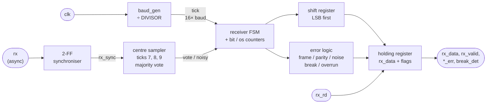
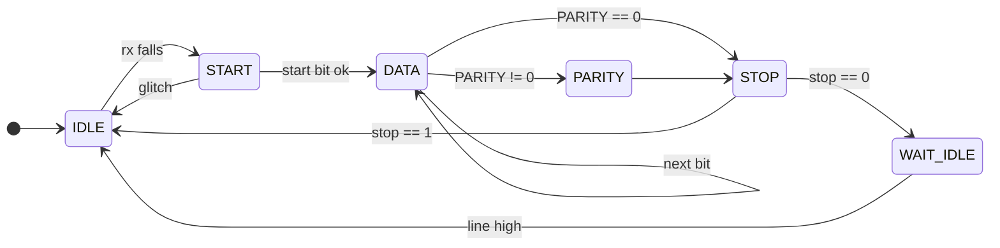
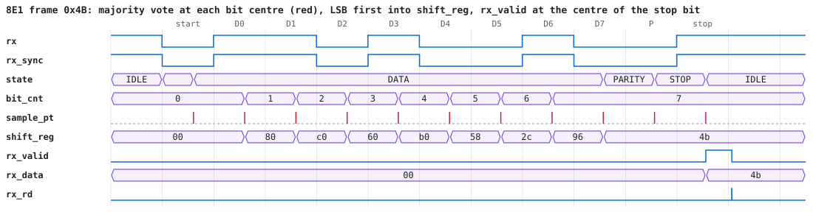
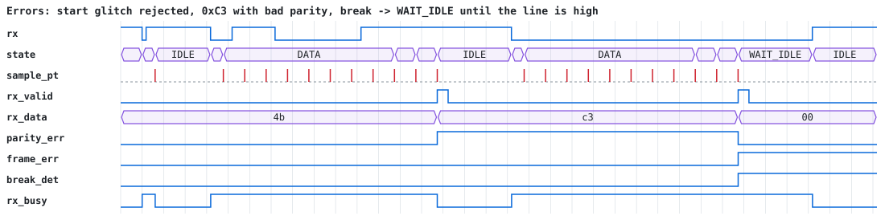

# uart-receiver-verilog

[](https://github.com/Aleksandar1567/uart-receiver-verilog/actions/workflows/ci.yml)
[](rtl/uart_rx.v)
[](docs/03-verification.md)
[](docs/03-verification.md)
[](#fpga-estimate)
[](LICENSE)

A parameterisable **UART receiver** in plain Verilog-2005: 2-FF synchroniser,
16× oversampling with a 3-sample majority vote, an FSM, and detection of
**framing, parity, noise, break and overrun** errors. It comes with a
self-checking testbench that runs 10 tests in 5 frame formats, plus
documentation that explains why each piece is there.

It's a learning project for RTL design: small enough to read in one sitting,
complete enough to drop into an FPGA design. Don't just copy it: simulate it,
break it on purpose, and see which test catches it
([exercises](docs/04-make-it-your-own.md)).

```
$ make test
  8N1        PASS  (words checked: 270 checks: 285 errors: 0)
  8E1        PASS  (words checked: 286 checks: 301 errors: 0)
  7O2        PASS  (words checked: 286 checks: 301 errors: 0)
  9E1-8x     PASS  (words checked: 286 checks: 301 errors: 0)
  8N1-9600   PASS  (words checked: 110 checks: 125 errors: 0)
```

## What's in it





- **RTL** ([`rtl/`](rtl)): `baud_gen` (tick generator) and `uart_rx`
  (everything else). No vendor primitives, Verilator `-Wall` clean.
- **Parameters**: `CLK_FREQ`, `BAUD_RATE`, `DATA_BITS` 5..9, `PARITY`
  none/odd/even, `STOP_BITS` 1..2, `OVERSAMPLE` ≥ 4.
- **Robustness**: metastability synchroniser, false-start rejection,
  majority vote, frame ends at the centre of the stop bit (tolerates ≈ ±3.9 %
  baud mismatch for 8N1), `WAIT_IDLE` so a break gives one word, not a flood.
- **Errors** reported per word, like a 16550's line status register.
- **Testbench** ([`tb/`](tb)): behavioural transmitter, scoreboard, monitor,
  glitch injector; directed, random, baud-mismatch and error-injection tests.
- **Diagrams**: waveforms and the netlist below are generated from the
  simulation and from Yosys (`make diagrams`), not drawn by hand.

| Port | Dir | Description |
|---|---|---|
| `clk`, `rst_n` | in | clock, async active-low reset |
| `rx` | in | serial line (asynchronous) |
| `rx_data[DATA_BITS-1:0]` | out | received word |
| `rx_valid` | out | `rx_data` not read yet |
| `rx_rd` | in | read strobe, clears `rx_valid` and `overrun_err` |
| `frame_err`, `parity_err`, `noise_err`, `break_det` | out | status of `rx_data` |
| `overrun_err` | out | a word was lost (sticky until `rx_rd`) |
| `rx_busy` | out | receiving a frame |

## Seen in the simulator

An 8E1 frame carrying 0x4B. Red marks are the decision points (tick 9 of 16,
after samples at 7 and 8). Bits shift in LSB first, and `rx_valid` rises at the
centre of the stop bit, half a bit before the frame ends:



Error handling: a 3/16-bit glitch is rejected in `START`; 0xC3 with a wrong
parity bit is delivered with `parity_err`; a break gives one 0x00 word with
`frame_err` + `break_det`, then the FSM waits in `WAIT_IDLE` until the line is
high again:



`baud_gen` as Yosys sees it: a 5-bit counter, compare with 26 (divisor 27 for
50 MHz → 16 × 115200), and the registered tick:


## FPGA estimate

`make synth`: default parameters (115200 8N1, 16×) on a Lattice LFE5U-25F with
Yosys + nextpnr:

| Resource | Used | Available |
|---|---|---|
| LUT4 + carry (TRELLIS_COMB) | 79 | 24288 |
| Flip-flops (TRELLIS_FF) | 45 | 24288 |
| **Fmax** (nextpnr) | **229 MHz** | target 50 MHz |

## Quick start

```bash
# Ubuntu: sudo apt install iverilog verilator   (or use OSS CAD Suite)
make test                                   # 10 tests x 5 frame formats
make sim PARITY=2 STOP_BITS=2               # one run with your own settings
make waves && gtkwave build/tb_uart_rx.vcd  # full testbench waveform
make lint                                   # Verilator -Wall
make diagrams                               # regenerate docs/img (needs npx for the netlist)
make synth                                  # Yosys + nextpnr-ecp5
```

Instantiate it:

```verilog
uart_rx #(
    .CLK_FREQ (50_000_000),
    .BAUD_RATE(115_200),
    .PARITY   (0)           // 0 none, 1 odd, 2 even
) u_rx (
    .clk(clk), .rst_n(rst_n), .rx(uart_rx_pin),
    .rx_data(data), .rx_valid(valid), .rx_rd(valid),   // read every word immediately
    .frame_err(), .parity_err(), .noise_err(), .break_det(),
    .overrun_err(), .rx_busy()
);
```

## Repository layout

```
rtl/
  baud_gen.v          OVERSAMPLE x baud tick
  uart_rx.v           synchroniser, sampler, FSM, error logic
tb/
  tb_uart_rx.v        self-checking testbench (10 tests, parameterised)
  tb_wave.v           short scenario for the README waveforms
scripts/
  wave_svg.py         VCD -> SVG waveform renderer
  netlist.sh          Yosys -> netlistsvg schematic
  synth.sh            Yosys + nextpnr-ecp5 estimate
docs/                 explanations (start with 01)
Makefile              test / sim / waves / lint / diagrams / synth
```

## Documentation

1. [The UART protocol, from the receiver's side](docs/01-uart-protocol.md):
   frame format, oversampling, baud tolerance, line errors
2. [Architecture](docs/02-architecture.md): synchroniser, sampler, FSM, error
   logic, overrun, design decisions
3. [Verification](docs/03-verification.md): testbench structure, test list,
   frame formats, mutation check, waveforms
4. [Make it your own](docs/04-make-it-your-own.md): exercises from easy to
   formal verification, plus interview questions

## Toolchain versions

| Tool | Version tested |
|---|---|
| Icarus Verilog | 11.0 (Ubuntu), 12 (CI), 14 devel (OSS CAD Suite) |
| Verilator | 5.020 (CI), 5.053 (OSS CAD Suite) |
| Yosys | 0.70 |
| nextpnr-ecp5 | 0.11 |
| netlistsvg | 1.0.2 (via `npx`) |
| Python | ≥ 3.8, standard library only |

## License

MIT.
