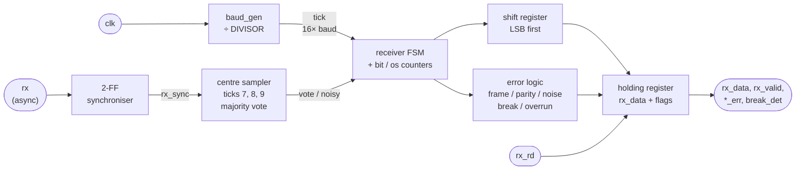
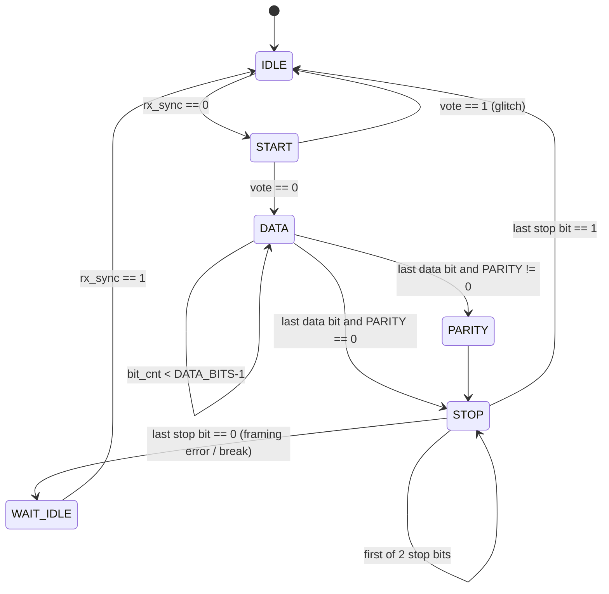

# 2. Architecture



Two files, no vendor primitives, plain Verilog-2005:

| File | Module | What |
|---|---|---|
| [`rtl/baud_gen.v`](../rtl/baud_gen.v) | `baud_gen` | one-cycle `tick` every `DIVISOR` clocks, `DIVISOR = round(CLK_FREQ / (BAUD_RATE · OVERSAMPLE))` |
| [`rtl/uart_rx.v`](../rtl/uart_rx.v) | `uart_rx` | synchroniser, sampler, FSM, error logic, holding register |

## Parameters

| Parameter | Default | Range | Meaning |
|---|---|---|---|
| `CLK_FREQ` | 50 000 000 | | system clock in Hz |
| `BAUD_RATE` | 115 200 | | bit rate |
| `DATA_BITS` | 8 | 5..9 | data bits per frame |
| `PARITY` | 0 | 0 / 1 / 2 | none / odd / even |
| `STOP_BITS` | 1 | 1..2 | stop bits |
| `OVERSAMPLE` | 16 | ≥ 4 | ticks per bit |

Out-of-range values stop elaboration with an `ERROR:` message.

## Ports

| Port | Dir | Width | Description |
|---|---|---|---|
| `clk` | in | 1 | system clock |
| `rst_n` | in | 1 | asynchronous, active-low reset |
| `rx` | in | 1 | serial input, asynchronous to `clk` |
| `rx_data` | out | `DATA_BITS` | last received word |
| `rx_valid` | out | 1 | `rx_data` holds a word that has not been read yet |
| `rx_rd` | in | 1 | one-cycle read strobe: clears `rx_valid` and `overrun_err` |
| `frame_err` | out | 1 | stop bit was 0 (belongs to `rx_data`) |
| `parity_err` | out | 1 | parity mismatch (belongs to `rx_data`) |
| `noise_err` | out | 1 | some bit had disagreeing samples (belongs to `rx_data`) |
| `break_det` | out | 1 | all-zero frame including the stop bit (belongs to `rx_data`) |
| `overrun_err` | out | 1 | a frame was dropped because `rx_valid` was still set; sticky until `rx_rd` |
| `rx_busy` | out | 1 | FSM is not in `IDLE` |

## Clock domain crossing: the synchroniser

`rx` comes from another chip with its own clock, so it can change at any moment
relative to `clk`. Sampling it directly risks **metastability**. Two flip-flops
in series (`rx_meta → rx_sync`) give the first one a full clock period to
settle. Both reset to `1`, the idle level, so reset never looks like a start
bit. Everything downstream only sees `rx_sync`. The cost is 2 clocks of latency,
nothing compared to a 434-clock bit.

## Baud tick and oversample counter

`baud_gen` is a free-running counter, here counting 0..26:


Inside a frame, `os_cnt` counts ticks 0..`OVERSAMPLE-1` and wraps, so it marks
the position inside the current bit. In `IDLE` it is held at 0, and the falling
edge of the start bit starts it: tick 0 ≈ start edge, tick 8 ≈ bit centre.

## Centre sampler and majority vote

```verilog
if (os_cnt == SMP_A) s0 <= rx_sync;            // tick MID-1
if (os_cnt == SMP_B) s1 <= rx_sync;            // tick MID
wire vote  = (s0 & s1) | (s0 & rx_sync) | (s1 & rx_sync);
wire noisy = ~((s0 == s1) && (s1 == rx_sync));
wire sample_pt = tick && (os_cnt == SMP_C);     // tick MID+1: decide
```

The FSM only acts at `sample_pt`, once per bit, so every state handles exactly
one bit per visit, or `DATA_BITS` / `STOP_BITS` bits for `DATA` / `STOP`.

## Receiver FSM



| State | At `sample_pt` |
|---|---|
| `IDLE` | (no sampling) waits for `rx_sync == 0`, holds `os_cnt = 0` |
| `START` | start bit still low? continue : false start, back to `IDLE` |
| `DATA` | `shift_reg <= {vote, shift_reg[DATA_BITS-1:1]}`, LSB first |
| `PARITY` | stores the parity bit |
| `STOP` | checks the stop bit; on the last one, writes the holding register and leaves |
| `WAIT_IDLE` | after a framing error or break: waits until the line is high again |

Two choices worth noticing:

- **The frame ends at the centre of the last stop bit.** The receiver is back
  in `IDLE` half a bit early, so it is ready even if the next start bit comes
  a little early (transmitter faster than receiver).
- **`WAIT_IDLE` after a framing error.** Without it, a break (line stuck low)
  would look like an endless stream of 0x00 frames. With it, a break gives
  exactly one word with `break_det = 1`, then silence until the line recovers.

## Error logic

All evaluated at the last stop-bit sample:

```verilog
wire ferr_final = ferr_acc | ~vote;                                // any stop bit low
wire perr_final = HAS_PAR && (par_bit != exp_par);                 // exp_par = ^data (even) / ~^data (odd)
wire brk_final  = ferr_final && (shift_reg == 0) && (!HAS_PAR || !par_bit);
```

`noise_acc` ORs `noisy` over every bit of the frame, start bit included.
Errors do not throw the data away: `rx_data` is still written and the flags
describe it, like a 16550's line status register. Software decides what to do.

With **odd** parity a break also sets `parity_err`, because a 0 parity bit is
wrong for all-zero data. With even parity it does not.

## Holding register and overrun

```
                  ┌── rx_valid == 0 ──> rx_data <= shift_reg, flags <= *_final, rx_valid <= 1
frame complete ───┤
                  └── rx_valid == 1 ──> overrun_err <= 1, frame dropped, old rx_data kept
```

A read (`rx_rd`) in the same cycle as a completing frame counts as "already
read", so the new word is accepted and no overrun is reported.

## Resources

Default parameters on a Lattice ECP5-25F (`make synth`): 79 LUT4, 45 flip-flops,
Fmax ≈ 229 MHz. The flip-flops are mostly the 8-bit shift register, the 8-bit
holding register, the five flags and the counters.

Next: [Verification](03-verification.md).
