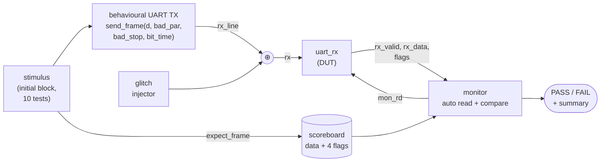

# 3. Verification



[`tb/tb_uart_rx.v`](../tb/tb_uart_rx.v) is **self-checking**: nobody has to
look at waveforms to know if it passed. It ends with `RESULT: PASS` or
`RESULT: FAIL`, and `make test` greps for that.

- **Transmitter**: a task that drives the line with real-valued delays, so the
  bit time can be anything (e.g. 2 % off). It can corrupt the parity bit or the
  stop bit on purpose.
- **Scoreboard**: every test first pushes what it expects (`data`, `frame_err`,
  `parity_err`, `break_det`, `noise_err`) and then sends.
- **Monitor**: whenever `rx_valid` is set it pulses `rx_rd`, pops the next
  expected entry and compares all five fields. A word with nothing expected is
  also a failure, and at the end the number of received words must equal the
  number expected, so missing words fail too.
- **Glitch injector**: XORed onto the line, used to flip exactly one of the
  three centre samples.

## Tests

| # | Test | Checks |
|---|---|---|
| 1 | Reset | outputs idle while `rst_n = 0` |
| 2 | Directed patterns | 0x00, 0xFF, 0x55, 0xAA, 0x01, 0x80, 0x0F, 0xF0 (masked to `DATA_BITS`) |
| 3 | Random | 200 random words, 0..3 idle bits between them, including back-to-back |
| 4 | Baud mismatch | 20 frames with the transmitter 2 % slow, 20 with it 2 % fast |
| 5 | Parity error | wrong parity bit → `parity_err`, the next good frame is clean |
| 6 | Framing error | stop bit 0 → `frame_err` with correct data, receiver recovers |
| 7 | Break | line low for ~3 frames → exactly **one** word, `break_det = frame_err = 1` |
| 8 | Glitch | 3/16-bit low pulses → no word, FSM back in `IDLE` |
| 9 | Noise | only the middle sample of D3 inverted → correct data, `noise_err = 1` |
| 10 | Overrun | two frames without reading → `overrun_err`, old word kept, `rx_rd` clears both |

## Frame formats

`make test` runs the whole list for each of these:

| Name | Format | Clock | Baud | Oversample | Divisor |
|---|---|---|---|---|---|
| `8N1` | 8N1 | 50 MHz | 115 200 | 16 | 27 |
| `8E1` | 8E1 | 50 MHz | 115 200 | 16 | 27 |
| `7O2` | 7O2 | 50 MHz | 115 200 | 16 | 27 |
| `9E1-8x` | 9E1 | 12 MHz | 115 200 | 8 | 13 |
| `8N1-9600` | 8N1 | 50 MHz | 9 600 | 16 | 326 |

```
$ make test
  8N1        PASS  (words checked: 270 checks: 285 errors: 0)
  8E1        PASS  (words checked: 286 checks: 301 errors: 0)
  7O2        PASS  (words checked: 286 checks: 301 errors: 0)
  9E1-8x     PASS  (words checked: 286 checks: 301 errors: 0)
  8N1-9600   PASS  (words checked: 110 checks: 125 errors: 0)
```

One run with your own settings:

```bash
make sim PARITY=1 DATA_BITS=7 STOP_BITS=2 BAUD_RATE=57600
```

## Does the testbench catch bugs?

A testbench that always passes proves nothing. Two deliberate bugs, each caught:

| Bug put into `uart_rx.v` | Result |
|---|---|
| even/odd parity swapped | `8E1`, `7O2`, `9E1-8x` FAIL (formats without parity still pass, correctly) |
| majority vote replaced by the middle sample only | all 5 formats FAIL (noise test) |

Try your own: break something in the RTL and see which test notices.

## Waveforms

```bash
make waves                       # build/tb_uart_rx.vcd, the full testbench
gtkwave build/tb_uart_rx.vcd     # or surfer
make diagrams                    # tb/tb_wave.v -> docs/img/*.svg
```

[`tb/tb_wave.v`](../tb/tb_wave.v) is a short 8E1 scenario (good frame, glitch,
bad parity, break) whose VCD is turned into the SVGs in the README by
[`scripts/wave_svg.py`](../scripts/wave_svg.py). CI regenerates them and fails
if they differ from the committed ones.

## Lint

```bash
make lint      # verilator --lint-only -Wall, three parameter sets, zero warnings
```

Next: [Make it your own](04-make-it-your-own.md).
